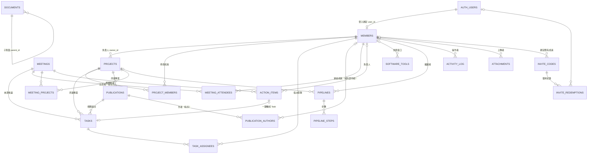

# TL Lab Hub — 資料庫 Schema

後端使用 Supabase（PostgreSQL 16 + Auth + Storage）。所有 SQL 都在 `supabase/migrations/`：

| 檔案 | 內容 |
|---|---|
| `20261029000001_schema.sql` | Enums、資料表、索引、`updated_at` / `completed_at` trigger、`lab_today()` |
| `20261029000002_auth_rls.sql` | 登入自動綁定成員、權限三級、Row Level Security policies |
| `20261029000003_activity_search_views.sql` | 活動紀錄 trigger、全站搜尋 `search_all()`、Dashboard 檢視與 KPI、Action item → Task |
| `20261029000004_storage.sql` | Storage buckets（`avatars`、`attachments`）與存取規則 |
| `20261029000005_invite_codes.sql` | 邀請碼註冊（Email＋密碼）：邀請碼、使用紀錄與伺服器端註冊函式 |
| `20261029000006_keep_author_names.sql` | 刪除成員時保留論文作者姓名 |
| `20261029000007_dashboard.sql` | `get_dashboard()`：Dashboard 所需資料一次取回 |
| `20261029000008_projects_tasks_publications_api.sql` | 專案／任務／論文的讀寫函式（網頁一律經由這些函式存取，權限仍由 RLS 決定） |
| `20261029000009_project_files.sql` | 專案頁面本文（Markdown，含版本號偵測同時編輯）、進度報告簡報附件、活動紀錄合併與截短 |
| `20261029000010_members_api.sql` | 成員列表／個人頁／編輯／刪除 API、邀請碼列表與撤銷（階段 5） |
| `20261029000011_system_admin.sql` | 系統管理員 `members.is_system_admin`（預設給 PI）：管理員的身分只有系統管理員能變更 |
| `20261029000013_resources_api.sql` | Resources API（階段 6）：文件、FAQ、軟體、Pipelines、會議與 Action items；`documents.content_version`、`meetings.summary_version` |
| `20261029000014_meeting_links.sql` | 會議相關連結 `meetings.links`（`[{label, url}]`，只保留 http(s) 網址、最多 20 筆） |
| `20261029000015_search_activity_settings.sql` | 全站搜尋回傳 `link_key`（文件網址代稱）並搜尋會議地點、Action items、FAQ／Pipeline 標籤；活動紀錄 API；頁面設定 API（階段 7） |
| `20261029000012_system_admin_ui.sql` | `is_system_admin` 只在 `app_role = 'admin'` 且非校友時有效；系統管理員可用 `save_member()` 指定／取消其他 Admin |
| `../seed.sql` | 示範資料（日期皆相對今天） |

## ER 圖



`ATTACHMENTS` 與 `ACTIVITY_LOG` 以 `(entity_type, entity_id)` 多型關聯到任一主要資料（project / task / publication / meeting / document / faq / software_tool / pipeline / member）。

## 資料表一覽

### About the team

| 資料表 | 對應 Notion | 主要欄位 |
|---|---|---|
| `members` | Team members | 姓名、英文名、照片、職稱 `position`、系統權限 `app_role`、Email、研究方向 `research_interests[]`、加入／離開年份、`is_alumni`、校友現職 |
| `projects` | Projects | 名稱、emoji、描述（MD）、負責人、狀態、開始日、預計完成日、進度 %、標籤 `tags[]`、顏色 |
| `project_members` | 參與成員 relation | 專案 × 成員、角色 |
| `tasks` | Tasks | 標題、描述、所屬專案、相關論文、來源會議、優先度、狀態、截止日、完成時間、看板排序 `position`、建立者 |
| `task_assignees` | 指派對象 relation | 任務 × 成員（可多人） |
| `publications` | Publication Tracker | 標題、類型、階段、目標期刊／會議、所屬專案、投稿日、截止日、接受日、發表日、DOI、連結、摘要、備註 |
| `publication_authors` | 作者 relation | 作者順序、連結成員或外部作者名、第一作者（可共同）、通訊作者 |

### Resources

| 資料表 | 對應 Notion | 主要欄位 |
|---|---|---|
| `documents` | Orientation Guide | 巢狀頁面（`parent_id`）、slug、emoji、Markdown 內容、排序；章節目錄由 Markdown 標題產生 |
| `faqs` | FAQ | 問題、答案（MD）、分類、標籤、排序 |
| `software_tools` | Software and Tools | 名稱、用途、分類、授權／帳號取得方式、安裝說明（MD）、連結、負責窗口 |
| `pipelines` / `pipeline_steps` | Pipelines | 說明、輸入／輸出、版本、維護者、所屬專案、repo；步驟含程式碼與語言（語法高亮） |
| `meetings` | Meeting Summary | 日期時間、類型、地點、摘要、決議事項；`starts_at` 在未來者即「下次會議」 |
| `meeting_attendees` | 出席者／報告人 | `is_presenter` 標記報告人 |
| `meeting_projects` | 會議 ↔ 專案 | 多對多 |
| `action_items` | Action items | 內容、負責人、截止日、完成、`task_id`（轉換後的任務） |

### 共通

| 資料表 | 用途 |
|---|---|
| `attachments` | 附件中繼資料；實體檔案在 Storage `attachments` bucket，路徑 `{entity_type}/{entity_id}/{uuid}.{ext}`。`kind = slides` 為進度報告，PPT/PPTX 由網頁伺服器以 LibreOffice 轉成 PDF（`preview_path`） |
| `activity_log` | 誰（`actor_id`）在何時對哪筆資料做了什麼（`insert` / `update` / `delete`），`changes` 記錄欄位新舊值；同一人 10 分鐘內的連續修改合併為一筆，長文字只保留前 300 字 |
| `page_settings` | 側邊欄各模組頁的 emoji 與中英文標題（Admin 可改）；個別資料列則各自有 `emoji` 欄位 |
| `invite_codes` | 邀請碼：只存 SHA-256 雜湊與末 4 碼；預設權限、職稱、限定 Email、綁定既有成員、可用次數、有效期限、撤銷 |
| `invite_redemptions` | 邀請碼使用紀錄（誰、何時、哪組碼） |

### 狀態值（enum）

| Enum | 值 | UI 顯示 |
|---|---|---|
| `member_position` | `pi` `postdoc` `phd` `master` `undergrad` `staff` | PI / Postdoc / PhD / Master / 專題生 / 研究助理 |
| `app_role` | `admin` `member` `viewer` | 管理者 / 成員 / 唯讀 |
| `project_status` | `planning` `active` `paused` `completed` | 規劃中 / 進行中 / 暫停 / 完成 |
| `task_priority` | `high` `medium` `low` | 高 / 中 / 低 |
| `task_status` | `todo` `in_progress` `in_review` `done` | 待辦 / 進行中 / 審核中 / 完成 |
| `publication_type` | `journal` `conference` `preprint` `thesis` | Journal / Conference / Preprint / Thesis |
| `publication_stage` | `idea` `drafting` `submitted` `revision` `accepted` `published` | 構想 / 撰寫中 / 投稿 / 審稿修改 / 接受 / 發表 |
| `meeting_type` | `lab_meeting` `one_on_one` `journal_club` | Lab meeting / 個別 meeting / Journal club |

> **校友的處理**：職稱 `position` 保留原本身分（例如 PhD），另以 `is_alumni = true` 標示為校友，畫面上顯示「校友 · PhD」並另外分區。校友預設權限為 `viewer`。

## 關聯（類似 Notion relation）

| 從 | 到 | 方式 |
|---|---|---|
| 任務 | 專案 / 論文 / 會議 | `tasks.project_id` / `publication_id` / `meeting_id` |
| 論文 | 專案 | `publications.project_id` |
| 會議 | 專案 | `meeting_projects`（多對多） |
| 會議 Action item | 任務 | `action_items.task_id`（`convert_action_item_to_task()` 一鍵轉換，自動帶入負責人、截止日與會議的專案） |
| 成員 | 專案 / 任務 / 論文 / 會議 | `projects.owner_id`、`project_members`、`task_assignees`、`publication_authors`、`meeting_attendees` |
| Pipeline | 專案 / 維護者 | `pipelines.project_id` / `maintainer_id` |

專案詳細頁可直接查詢該專案的任務、論文（`project_id`）、會議紀錄（`meeting_projects`）。

## 權限（RLS）

登入方式：Email＋密碼，註冊需要邀請碼。Supabase 的公開註冊保持關閉，註冊由網頁伺服器端（service_role）依序執行：

1. `claim_invite_code(code, email)`：原子性驗證並佔用一次邀請碼；邀請碼不分大小寫、可省略連字號；錯誤時不透露是哪一項不符。
2. `auth.admin.createUser(email, password, email_confirm: true)`：`handle_new_auth_user()` 依 email（不分大小寫）綁定既有成員，或建立新成員（預設 `viewer`）。失敗時呼叫 `release_invite_code()` 歸還次數。
3. `complete_invite_signup(invite_id, user_id)`：套用邀請碼的權限與職稱，並寫入使用紀錄。

Admin 以 `create_invite_code()` 產生邀請碼（格式 `TL-XXXX-XXXX-XXXX-XXXX`，64 bits 隨機）。邀請碼只有 Admin 看得到；上述三個伺服器端函式只有 `service_role` 能執行。

| 動作 | Admin | Member | Viewer | 未登入 |
|---|---|---|---|---|
| 讀取所有資料 | ✅ | ✅ | ✅ | ❌ |
| 新增專案／任務／論文／會議／文件 | ✅ | ✅（`created_by` 必須是自己） | ❌ | ❌ |
| 編輯專案 | ✅ | 負責人、參與成員、建立者 | ❌ | ❌ |
| 編輯任務 | ✅ | 建立者、被指派者、可編輯該專案者 | ❌ | ❌ |
| 編輯論文 | ✅ | 建立者、作者、可編輯該專案者 | ❌ | ❌ |
| 編輯會議與 Action items | ✅ | 建立者、出席者（被指派者可改自己的 action item） | ❌ | ❌ |
| 編輯 Orientation Guide / FAQ / 軟體工具 | ✅ | ✅（協作 wiki） | ❌ | ❌ |
| 編輯 Pipeline | ✅ | 建立者、維護者 | ❌ | ❌ |
| 刪除 | ✅ | 自己建立的（專案另含負責人） | ❌ | ❌ |
| 編輯成員資料 | ✅（管理員的權限／職稱／Email／校友狀態只有系統管理員能改） | 只能改自己的個人資料，不能改權限／Email／校友狀態 | ❌ | ❌ |
| 刪除管理員、重設管理員密碼 | 僅系統管理員 | ❌ | ❌ | ❌ |
| 修改頁面 emoji 設定 | ✅ | ❌ | ❌ | ❌ |
| 產生／查看／撤銷邀請碼 | ✅ | ❌ | ❌ | ❌ |

另有保護：系統至少保留一位 Admin 與一位系統管理員（`members_protect_admin` trigger；不再是 Admin 或成為校友時自動取消系統管理員；只有系統管理員能指定或取消系統管理員）；活動紀錄只能由 trigger 寫入，使用者無法竄改。

## 函式與檢視

| 名稱 | 說明 |
|---|---|
| `search_all(q, max_results)` | 全站搜尋：成員、專案、任務、論文、會議（含地點、Action items）、文件、FAQ、軟體、Pipelines；中英文部分比對，依相似度排序，遵守 RLS；`link_key` 為文件的網址代稱 |
| `list_activity(filter)` | 活動紀錄（篩選 `entity_type`、`entity_id`、`actor_id`；`before` 為上一頁最後一筆 id）；依時間排序，只改到帳號綁定等內部欄位的更新不列出；`link_key` 為 null 代表資料已刪除 |
| `list_page_settings()` / `save_page_setting(key, emoji, title, title_en)` | 側邊欄頁面名稱與圖示（修改限 Admin） |
| `get_dashboard(p_days)` | Dashboard 一次取回：KPI、我的任務（前 8 項）、專案進度、論文各階段數量與最新 3 篇、最近 3 場會議、下次會議、未來 14 天截止日；依呼叫者 RLS |
| `dashboard_kpis()` | 進行中專案數、本週待辦任務數、逾期任務數、今年已發表數、投稿中（投稿＋審稿修改）數 |
| `v_project_overview` | 每個專案的手動進度、任務總數／完成數／逾期數與任務完成率 |
| `v_upcoming_deadlines` | 未完成任務＋尚未接受論文的截止日，含相關成員（Dashboard 取未來 14 天） |
| `v_publication_stage_counts` | 論文各階段數量（看板統計） |
| `convert_action_item_to_task(id)` | Action item 一鍵轉 Task |
| `lab_today()` | 以 Asia/Taipei 計算的「今天」 |
| `form_options()` | 表單下拉選單：成員、專案、論文，以及目前使用者能否新增 |
| `list_projects(filter)` / `get_project(id)` | 專案列表（含負責人、成員、任務統計、`editable`／`deletable`）；詳細頁另含任務、論文、會議 |
| `save_project(p)` / `delete_project(id)` | 新增或更新專案與參與成員；無權限時回 42501 |
| `list_tasks(filter)` | 篩選：`mine`、`member_id`、`project_id`、`overdue`、`status`、`q`、`due_from`／`due_to` |
| `save_task(p)` / `move_task(id, status, position)` / `delete_task(id)` | 任務與指派對象；`move_task` 供看板拖拉 |
| `list_publications(filter)` | 篩選：`stage`、`type`、`project_id`、`member_id`（作者）、`year`、`q` |
| `save_publication(p)` / `delete_publication(id)` | 論文與有序作者清單（成員或外部作者、第一／通訊作者） |
| `publication_year_stats()` | 各年度已發表數（依類型）與投稿數 |
| `save_project_content(id, content, version)` | 專案頁面自動儲存；版本不符回 40001（他人已先儲存），不會覆蓋 |
| `list_attachments(entity_type, entity_id)` | 附件列表（上傳者、是否可刪除、PDF 預覽路徑） |
| `list_members(filter)` / `get_member(id)` | 成員列表（篩選 `position`、`alumni`、`q` 比對姓名／Email／研究方向；含參與專案、是否已註冊、`editable`）；個人頁另含論文與未完成任務 |
| `save_member(p)` | 新增（僅 Admin）或更新成員；本人只能改個人資料，職稱／權限／Email／校友／排序由 Admin 修改（一般成員送來的值會被忽略）；連結只保留 `http(s)://` 網址 |
| `delete_member(id)` | 刪除成員（僅 Admin、不能刪自己），回傳原本的登入帳號 id，讓伺服器一併刪除帳號 |
| `member_user_id(id)` | 成員的登入帳號 id（Admin 重設密碼用；其他管理員的只有系統管理員能取得） |
| `is_system_admin()` | 目前使用者是否為系統管理員；`member_json` 另回傳 `is_system_admin` 與 `manageable`（能否變更此成員的身分） |
| `list_invite_codes()` / `revoke_invite_code(id)` | 邀請碼列表（狀態 active／used／expired／revoked、已使用者 Email）與撤銷（僅 Admin） |
| `list_documents(kind)` / `get_document(slug)` | Orientation 目錄（不含內文）與單頁（含內文、版本號、更新者） |
| `save_document(p)` / `save_document_content(id, content, version)` / `delete_document(id)` | 頁面資訊（網址代稱空白時自動產生，英數標題轉 `a-b-c`、其他用 `page-xxxxxx`；上層不能是自己或子頁面）；內文自動儲存，版本不符回 40001 |
| `list_faqs(filter)` / `faq_categories()` / `save_faq(p)` / `delete_faq(id)` | FAQ（篩選 `category`、`q` 比對問題／回答／標籤） |
| `list_software(filter)` / `get_software(id)` / `save_software(p)` / `delete_software(id)` | 軟體與工具；網址只接受 `http(s)://` |
| `list_pipelines(filter)` / `get_pipeline(id)` / `save_pipeline(p)` / `delete_pipeline(id)` | Pipelines（篩選 `tag`、`q`）；`steps` 以傳入陣列為準重新編號 |
| `list_meetings(filter)` / `get_meeting(id)` / `save_meeting(p)` / `delete_meeting(id)` | 會議（篩選 `type`、`member_id`、`project_id`、`q` 含紀錄內文）；出席者 `[{member_id, is_presenter}]`、相關專案 |
| `save_meeting_summary(id, content, version)` | 會議紀錄即時編輯；版本不符回 40001 |
| `save_action_item(p)` / `delete_action_item(id)` | Action item 新增／更新；已轉為任務時，勾選完成會同步任務狀態（有權限時） |
| `create_invite_code(...)` | 產生邀請碼（Admin），回傳原文一次 |
| `claim_invite_code` / `release_invite_code` / `complete_invite_signup` | 邀請碼註冊流程（僅 service_role） |

## Notion 匯入（階段 8 預留）

主要資料表都有 `notion_id`（unique），匯入 Notion 匯出的 CSV／Markdown 時以此去重，重複匯入會更新而非重複建立。

## 本機測試

```bash
scripts/test-db.sh
```

會在暫存的 PostgreSQL 16 上模擬 Supabase 的 `auth`／`storage` schema，依序套用 migrations、seed，並執行 `supabase/tests/rls_test.sql`（登入綁定、各權限等級讀寫、活動紀錄、搜尋、KPI、Action item 轉換、Admin 保護、邀請碼註冊），最後測試備份與還原。階段 4 的 API 測試包含：權限邊界（無關專案不可改、唯讀帳號不可新增）、只有作者身分者修改作者清單、搜尋字詞跳脫、日期與標題驗證。
