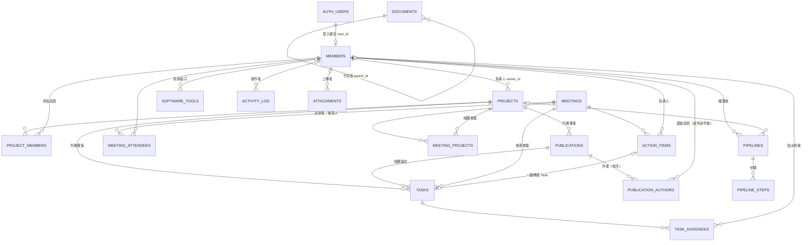

# TL Lab Hub — 資料庫 Schema

後端使用 Supabase（PostgreSQL 16 + Auth + Storage）。所有 SQL 都在 `supabase/migrations/`：

| 檔案 | 內容 |
|---|---|
| `20261029000001_schema.sql` | Enums、資料表、索引、`updated_at` / `completed_at` trigger、`lab_today()` |
| `20261029000002_auth_rls.sql` | 登入自動綁定成員、權限三級、Row Level Security policies |
| `20261029000003_activity_search_views.sql` | 活動紀錄 trigger、全站搜尋 `search_all()`、Dashboard 檢視與 KPI、Action item → Task |
| `20261029000004_storage.sql` | Storage buckets（`avatars`、`attachments`）與存取規則 |
| `../seed.sql` | 示範資料（日期皆相對今天） |

## ER 圖



`ATTACHMENTS` 與 `ACTIVITY_LOG` 以 `(entity_type, entity_id)` 多型關聯到任一主要資料（project / task / publication / meeting / document / faq / software_tool / pipeline / member）。

## 資料表一覽

### About the team

| 資料表 | 對應 Notion | 主要欄位 |
|---|---|---|
| `members` | Team members | 姓名、英文名、照片、職稱 `position`、系統權限 `app_role`、Email、研究方向 `research_interests[]`、加入／離開年份、`is_alumni`、校友現職 |
| `projects` | Projects | 名稱、emoji、描述（MD）、負責人、狀態、開始日、預計完成日、進度 %、標籤 `tags[]`、顏色 |
| `project_members` | 參與成員 relation | 專案 × 成員、角色 |
| `tasks` | Tasks | 標題、描述、所屬專案、相關論文、來源會議、優先度、狀態、截止日、完成時間、看板排序 `position`、建立者 |
| `task_assignees` | 指派對象 relation | 任務 × 成員（可多人） |
| `publications` | Publication Tracker | 標題、類型、階段、目標期刊／會議、所屬專案、投稿日、截止日、接受日、發表日、DOI、連結、摘要、備註 |
| `publication_authors` | 作者 relation | 作者順序、連結成員或外部作者名、第一作者（可共同）、通訊作者 |

### Resources

| 資料表 | 對應 Notion | 主要欄位 |
|---|---|---|
| `documents` | Orientation Guide | 巢狀頁面（`parent_id`）、slug、emoji、Markdown 內容、排序；章節目錄由 Markdown 標題產生 |
| `faqs` | FAQ | 問題、答案（MD）、分類、標籤、排序 |
| `software_tools` | Software and Tools | 名稱、用途、分類、授權／帳號取得方式、安裝說明（MD）、連結、負責窗口 |
| `pipelines` / `pipeline_steps` | Pipelines | 說明、輸入／輸出、版本、維護者、所屬專案、repo；步驟含程式碼與語言（語法高亮） |
| `meetings` | Meeting Summary | 日期時間、類型、地點、摘要、決議事項；`starts_at` 在未來者即「下次會議」 |
| `meeting_attendees` | 出席者／報告人 | `is_presenter` 標記報告人 |
| `meeting_projects` | 會議 ↔ 專案 | 多對多 |
| `action_items` | Action items | 內容、負責人、截止日、完成、`task_id`（轉換後的任務） |

### 共通

| 資料表 | 用途 |
|---|---|
| `attachments` | 圖片與附件的中繼資料；實體檔案在 Storage `attachments` bucket，路徑 `{entity_type}/{entity_id}/{檔名}` |
| `activity_log` | 誰（`actor_id`）在何時對哪筆資料做了什麼（`insert` / `update` / `delete`），`changes` 記錄欄位新舊值 |
| `page_settings` | 側邊欄各模組頁的 emoji 與中英文標題（Admin 可改）；個別資料列則各自有 `emoji` 欄位 |

### 狀態值（enum）

| Enum | 值 | UI 顯示 |
|---|---|---|
| `member_position` | `pi` `postdoc` `phd` `master` `undergrad` `staff` | PI / Postdoc / PhD / Master / 專題生 / 研究助理 |
| `app_role` | `admin` `member` `viewer` | 管理者 / 成員 / 唯讀 |
| `project_status` | `planning` `active` `paused` `completed` | 規劃中 / 進行中 / 暫停 / 完成 |
| `task_priority` | `high` `medium` `low` | 高 / 中 / 低 |
| `task_status` | `todo` `in_progress` `in_review` `done` | 待辦 / 進行中 / 審核中 / 完成 |
| `publication_type` | `journal` `conference` `preprint` `thesis` | Journal / Conference / Preprint / Thesis |
| `publication_stage` | `idea` `drafting` `submitted` `revision` `accepted` `published` | 構想 / 撰寫中 / 投稿 / 審稿修改 / 接受 / 發表 |
| `meeting_type` | `lab_meeting` `one_on_one` `journal_club` | Lab meeting / 個別 meeting / Journal club |

> **校友的處理**：職稱 `position` 保留原本身分（例如 PhD），另以 `is_alumni = true` 標示為校友，畫面上顯示「校友 · PhD」並另外分區。校友預設權限為 `viewer`。

## 關聯（類似 Notion relation）

| 從 | 到 | 方式 |
|---|---|---|
| 任務 | 專案 / 論文 / 會議 | `tasks.project_id` / `publication_id` / `meeting_id` |
| 論文 | 專案 | `publications.project_id` |
| 會議 | 專案 | `meeting_projects`（多對多） |
| 會議 Action item | 任務 | `action_items.task_id`（`convert_action_item_to_task()` 一鍵轉換，自動帶入負責人、截止日與會議的專案） |
| 成員 | 專案 / 任務 / 論文 / 會議 | `projects.owner_id`、`project_members`、`task_assignees`、`publication_authors`、`meeting_attendees` |
| Pipeline | 專案 / 維護者 | `pipelines.project_id` / `maintainer_id` |

專案詳細頁可直接查詢該專案的任務、論文（`project_id`）、會議紀錄（`meeting_projects`）。

## 權限（RLS）

登入流程：Admin 先以 email 建立成員 → 成員以 Google 或 Email 登入 → `handle_new_auth_user()` 自動以 email（不分大小寫）綁定並沿用預設權限。未事先登記的帳號會自動建立為 `viewer`，等待 Admin 調整。

| 動作 | Admin | Member | Viewer | 未登入 |
|---|---|---|---|---|
| 讀取所有資料 | ✅ | ✅ | ✅ | ❌ |
| 新增專案／任務／論文／會議／文件 | ✅ | ✅（`created_by` 必須是自己） | ❌ | ❌ |
| 編輯專案 | ✅ | 負責人、參與成員、建立者 | ❌ | ❌ |
| 編輯任務 | ✅ | 建立者、被指派者、可編輯該專案者 | ❌ | ❌ |
| 編輯論文 | ✅ | 建立者、作者、可編輯該專案者 | ❌ | ❌ |
| 編輯會議與 Action items | ✅ | 建立者、出席者（被指派者可改自己的 action item） | ❌ | ❌ |
| 編輯 Orientation Guide / FAQ / 軟體工具 | ✅ | ✅（協作 wiki） | ❌ | ❌ |
| 編輯 Pipeline | ✅ | 建立者、維護者 | ❌ | ❌ |
| 刪除 | ✅ | 自己建立的（專案另含負責人） | ❌ | ❌ |
| 編輯成員資料 | ✅ | 只能改自己的個人資料，不能改權限／Email／校友狀態 | ❌ | ❌ |
| 修改頁面 emoji 設定 | ✅ | ❌ | ❌ | ❌ |

另有保護：系統至少保留一位 Admin；活動紀錄只能由 trigger 寫入，使用者無法竄改。

## 函式與檢視

| 名稱 | 說明 |
|---|---|
| `search_all(q, max_results)` | 全站搜尋：成員、專案、任務、論文、會議、文件、FAQ、軟體、Pipelines；中英文部分比對，依相似度排序，遵守 RLS |
| `dashboard_kpis()` | 進行中專案數、本週待辦任務數、逾期任務數、今年已發表數、投稿中（投稿＋審稿修改）數 |
| `v_project_overview` | 每個專案的手動進度、任務總數／完成數／逾期數與任務完成率 |
| `v_upcoming_deadlines` | 未完成任務＋尚未接受論文的截止日，含相關成員（Dashboard 取未來 14 天） |
| `v_publication_stage_counts` | 論文各階段數量（看板統計） |
| `convert_action_item_to_task(id)` | Action item 一鍵轉 Task |
| `lab_today()` | 以 Asia/Taipei 計算的「今天」 |

## Notion 匯入（階段 8 預留）

主要資料表都有 `notion_id`（unique），匯入 Notion 匯出的 CSV／Markdown 時以此去重，重複匯入會更新而非重複建立。

## 本機測試

```bash
scripts/test-db.sh
```

會在暫存的 PostgreSQL 16 上模擬 Supabase 的 `auth`／`storage` schema，依序套用 migrations、seed，並執行 `supabase/tests/rls_test.sql`（登入綁定、各權限等級讀寫、活動紀錄、搜尋、KPI、Action item 轉換、Admin 保護）。
